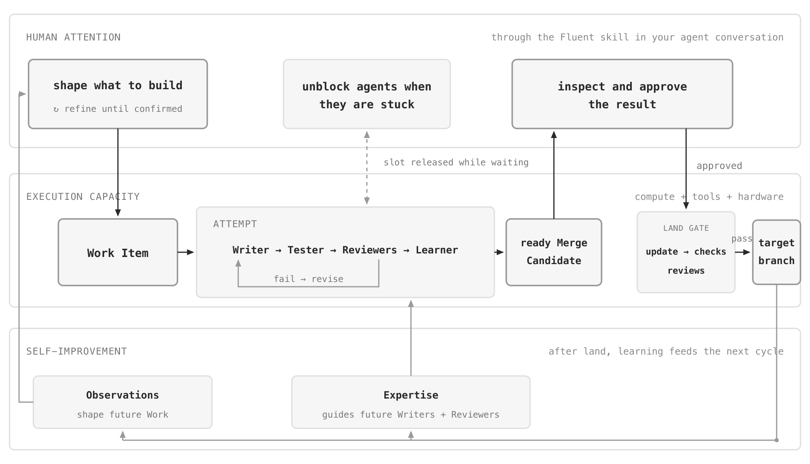
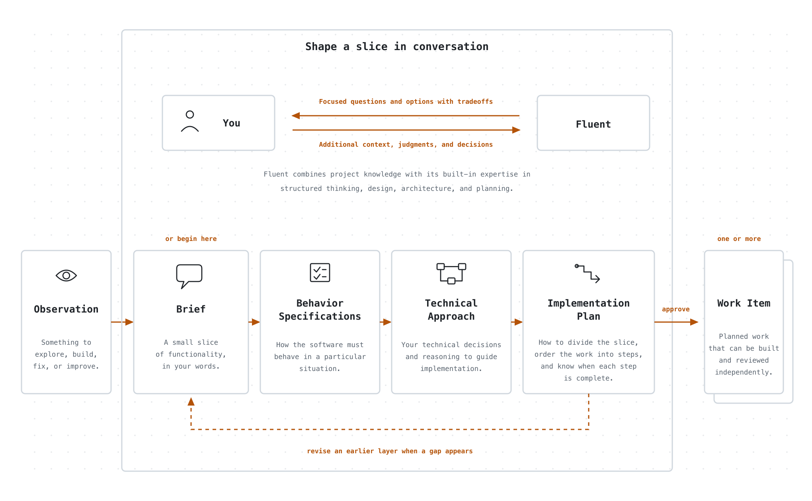
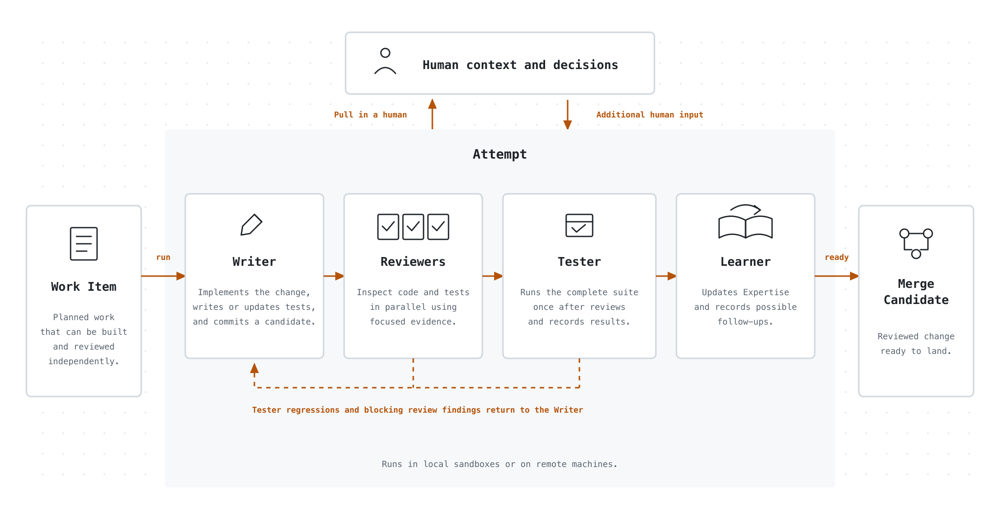

# Fluent – a self improving software factory

Fluent is a factory that autonomously turns your team's vision, ideas, bug reports, user feedback, production logs, and agent traces into working software.

<p align="center">
  <picture>
    <source media="(prefers-color-scheme: dark)" srcset=".github/assets/fluent-at-a-glance-dark.gif">
    <source media="(prefers-color-scheme: light)" srcset=".github/assets/fluent-at-a-glance-light.gif">
    
  </picture>
</p>

You use the factory through the Fluent [skill](https://agentskills.io/) in Codex, Claude Code, Pi, or another coding agent that supports skills. The skill turns your conversation into Fluent's interface and drives its command-line machinery for you.

### Install

```bash
npx skills add mrinalwadhwa/fluent --skill fluent  # currently macOS only
```

Use the command above from the project where you want Fluent. The `skills` CLI
creates a project skill directory (commonly `.agents/skills/fluent` for Codex,
or the agent-specific `.codex/skills/fluent` and `.claude/skills/fluent` roots)
and records the source in `skills-lock.json`. Review and commit those
project-local files according to your repository's policy.

The installed skill is a small bootstrap. On its first invocation,
`fluent skills add` replaces that marked bootstrap with the full skill and a
Fluent ownership sidecar. It also removes only Fluent's entry from
`skills-lock.json`, so `npx skills update` cannot restore the bootstrap; other
skills in the lock remain unchanged. Repeating the Fluent command leaves a
current managed installation untouched. The bare command does not create an
absent `.claude` or `.codex` skill root.

To install the interactive skill somewhere other than the detected bootstrap,
name both the agent and the scope:

```bash
fluent skills add --agent codex --project
fluent skills add --agent claude --global
fluent skills add --agent codex,claude --global
```

These commands choose where you invoke Fluent. The coder profile selected by
`fluent init` separately chooses which providers run Writer and reviewer work.

Start your coding agent in the project folder, then ask it to use Fluent and
describe what you want to explore, build, fix, or improve.

The first invocation sets up Fluent for that project and starts shaping the work with you. You can also invoke the skill explicitly: `$fluent` in Codex, `/fluent` in Claude Code, or `/skill:fluent` in Pi.

For autonomous Codex work, Fluent accepts a standalone `codex` executable or
an official npm installation whose platform-native package is paired with that
wrapper version. An incomplete or mismatched npm installation is rejected
before work starts; reinstall that Codex version rather than weakening Fluent's
sandbox.

### Upgrade

Run `fluent update` to install the latest binary. Starting with v0.1.5, Fluent
downloads the release checksum and verifies the binary before replacing the
installed executable. It then refreshes existing managed skill installations
without creating new agent roots. After upgrading from an earlier release,
rebuild stored artifact metrics once with `fluent work-item rebuild-metrics` if
you want historical Work Items to report their complete storage totals
immediately.

If an older Work Item was written before the current split-record format, make
its conversion explicit with `fluent work-item upgrade <work-item-id>` (or omit
the ID to process all stored Work Items). Fluent records the source and target
format in an audit file, rewrites the records transactionally, and treats a
repeat as a no-op. Unknown future formats are rejected rather than guessed.

See the [v0.6.0 release notes](documentation/releases/v0.6.0.md) for behavior
changes, assurance limits, and recovery commands.
For a transition from v0.5.0 with a shared scheduler, follow the
[next-release transition procedure](documentation/releases/next.md).

## How Fluent works

Fluent separates work that needs human attention from work agents can do on their own. You can think of it as two conceptual queues. The first queue waits for people with the right context, judgment, expertise, or authority. The second waits on both agent and compute capacity: room to run an agent within subscription, rate, and budget limits, and a suitable environment with the models, tools, and hardware the work needs.

<p align="center">
  <picture>
    <source media="(prefers-color-scheme: dark)" srcset=".github/assets/fluent-overall-flow-dark.png">
    <source media="(prefers-color-scheme: light)" srcset=".github/assets/fluent-overall-flow-light.png">
    
  </picture>
</p>

Whenever you encounter something to explore, build, fix, or improve, ask Fluent to record it as an Observation. Add whatever context you have in the moment; you do not need to know the solution or have worked out every detail. Agents and connected systems can record Observations too. You can return to any Observation later and refine it on your own timeline, bringing in someone with the right expertise or authority when needed.

When you want to act on an Observation, ask Fluent to start shaping it. Once shaping produces a Work Item, ask Fluent to run it directly or add it to the queue. A queued Work Item waits until suitable agent and compute capacity is available. If its Attempt needs human context or a decision, Fluent places the question in the human queue for you or someone with the right expertise or authority to answer. The Attempt waits for that answer while other ready Work Items can continue.

## How you tell Fluent what to build

Ask Fluent to help shape what you want to build. You can start from an Observation you recorded earlier or begin directly with a Brief. Fluent reads the relevant project code along with the reusable conventions, constraints, and lessons captured as project Expertise.

You do not need to arrive with a finished specification. Fluent collaborates with you as the slice takes shape. It grounds the conversation in the code and project Expertise, checks that it understands what you mean, and asks one focused question at a time. It uses structured methods for problem framing, behavior design, architecture, and planning to challenge assumptions, find missing cases, research technical choices, and present options with their tradeoffs. You provide context and judgment and make each decision.

<p align="center">
  <picture>
    <source media="(prefers-color-scheme: dark)" srcset=".github/assets/how-you-tell-fluent-dark.png">
    <source media="(prefers-color-scheme: light)" srcset=".github/assets/how-you-tell-fluent-light.png">
    
  </picture>
</p>

The conversation produces four layers of shared context:

**Brief.** A Brief describes one small slice of functionality. Fluent is designed to help you turn that slice into working software without first specifying the entire system. The Brief captures, in your words, what you want and why, grounded in the relevant project context. It keeps constraints, assumptions, and unknowns explicit without choosing a solution.

**Behavior Specifications.** A Behavior Specification precisely describes how the software must behave in a particular situation. It is written so the specified observable behavior can be verified without prescribing its implementation.

For the slice described in the Brief, Fluent reads the project’s existing Behavior Specifications and relevant code to understand what the software already guarantees. It then works with you to define the additions, changes, or removals needed for that slice. The result is a behavior diff, not a restatement of the entire system. If the project has no existing Behavior Specifications, the first slice starts them.

Before writing Behavior Specifications, Fluent makes the important terms precise and maps the people and systems involved, the events that occur, and the states that matter. For a small slice, it considers only what changes. It works through one area at a time, proposing a few core behaviors before asking about gaps and important edge cases. If Fluent derives a behavior that was not stated in the Brief, it labels the behavior as derived so you can accept or reject it. Decisions about libraries, protocols, storage, and other solution choices wait for the Technical Approach.

Fluent writes each Behavior Specification in a consistent form that names the situation and the required response. For example:

```text
WHEN a user selects Save on a draft,
THE SYSTEM SHALL show a `Saved` status beside the draft title.
Test: tests/drafts.spec.ts (shows_saved_status_after_save)
```

It describes something a person can observe and a test can verify, without choosing a UI framework, component structure, or persistence mechanism.

Fluent writes Behavior Specifications in EARS, the Easy Approach to Requirements Syntax. EARS uses a small set of patterns that make the triggering event or condition and the required response explicit.

Every new behavior includes either a `Test:` reference or an `Untestable:` reason. While defining the behavior, Fluent inspects nearby tests and names the intended test in the project’s existing style. A reference may name a project test path and selector, a Rust library test as `cargo test --lib <test-name>`, or a direct Python script command such as `python3 tests/readiness.py`. The referenced test may not exist yet. The Writer creates or updates it during implementation. Candidate checks resolve a Cargo library selector to one committed library in the candidate workspace, either at the package root or in a virtual workspace member such as `crates/model-gateway`. For a standalone root package, the committed manifest establishes the package and library identity even if the worktree manifest changes; the library sources must still match the commit. For virtual workspaces, the root and selected member manifests and library sources must match the commit. In both cases, Fluent requires a passing native Rust result with the exact package and library target from the final Tester. They validate a Python command's script against the committed candidate and normally require the exact complete command in final Tester evidence. If one command intentionally needs a different host, Fluent pauses before another Writer, requests candidate-bound evidence for that exact command, and sends it through a targeted Tests Review. When the test passes, the Behavior Reviewer uses that as evidence that the behavior was delivered.

**Technical Approach.** The Technical Approach document captures your technical expertise and judgment before the work is delegated to agents. You and Fluent decide the key technical choices that should guide implementation, including structure, interfaces, protocols, libraries, storage, and integrations. The document gives the Writer both the decisions and the reasoning behind them, while leaving implementation details that agents can safely determine during the work.

**Implementation Plan.** The Implementation Plan turns the confirmed behaviors and technical decisions into work that agents can carry out. You and Fluent decide whether the slice should become one Work Item or several independently reviewable Work Items that can run in parallel. When steps help the Writer, the Implementation Plan divides a Work Item into steps that state what will become observably true, which behaviors each step delivers, and how the result will be verified. Fluent orders those steps by what must be built first. A small mechanical Work Item can use a minimal plan without inventing steps. When Work Items depend on one another, the plan pins the interfaces they share and the points at which their work must come together.

You confirm each layer before Fluent uses it as the foundation for the next. The conversation can also move backward. If the Technical Approach reveals missing behavior, you return to the Behavior Specifications. If the Implementation Plan exposes an unresolved technical decision, you return to the Technical Approach rather than leaving the Writer to guess.

When you confirm the Implementation Plan, Fluent creates one Work Item for each independently reviewable part of the slice. Each Work Item carries the approved Brief, Behavior Specifications, Technical Approach, and the part of the Implementation Plan its agents must deliver. Creating a Work Item records the handoff. It does not run or queue the Work Item.

Ask Fluent to run a Work Item directly, or add it to the queue to wait for agent and compute capacity. Each time Fluent runs a Work Item, it creates an Attempt. The Attempt tracks that execution through the Writer, Tester, Reviewers, and Learner, including every revision, test run, review, and pause. Separate Work Items can proceed independently. Within an Attempt, the Writer follows any dependencies and ordering recorded in the Implementation Plan and tracks its progress in `progress.md`.

## How Fluent builds it

Fluent gives each Attempt an isolated Git worktree, keeping its changes separate from your working copy. It can run the Writer, Tester, Reviewer, and Learner tasks in a local sandbox or delegate them to a remote machine, currently through AWS Fargate. If the Attempt needs human context or a decision, Fluent returns the question to the human queue.

<p align="center">
  <picture>
    <source media="(prefers-color-scheme: dark)" srcset=".github/assets/how-fluent-builds-dark.png">
    <source media="(prefers-color-scheme: light)" srcset=".github/assets/how-fluent-builds-light.png">
    
  </picture>
</p>

Within the Attempt, the Writer receives the approved Brief, Behavior Specifications, Technical Approach, and its assigned part of the Implementation Plan, along with the relevant code, project Expertise, and instructions. It implements the change, writes or updates its tests, runs focused harness-native checks, and commits a candidate for review. Its final message reports the exact checks and what they covered.

Reviewers treat the Writer’s focused report as advisory evidence, inspect the implementation and tests themselves, and do not rerun the full suite. If one concrete result is missing, the Tests Reviewer may run one named harness-native check. If its read-only environment cannot run that check, it records the exact command and candidate-relative working directory instead of requesting a source change. Fluent pauses for explicit `fluent attempt evidence run` authorization, which schedules a verification Task bound to the candidate. Run the printed Task command, then `fluent attempt run` to validate its receipt and rerun only the Tests Reviewer. The worker uses private writable scratch against read-only candidate source and retains detailed logs in its Task artifacts. A source finding still returns directly to the Writer, avoiding a complete-suite run for a candidate that is already known to need correction.

After every Reviewer passes, the Tester runs once as the authoritative final gate. It is a deterministic runner, not a coding agent. It reads one or more test commands from the project’s `.fluent/tester.yaml`, runs them sequentially in the candidate workspace, and captures each command’s output, exit code, and duration. The project’s `.fluent/extract-tester-results` executable normalizes those outputs into a single `tester-results.json` artifact, which Fluent binds to the exact reviewed commit. An introduced regression or infrastructure error returns to the Writer; a clean result advances the candidate to Learning.

Some test tools update tracked lockfiles or generated metadata as a side effect. A Work Task Tester starts only from a clean tracked candidate and restores tracked side effects after each run while retaining the original command evidence. It leaves untracked and ignored build outputs alone; a preexisting tracked edit or changed candidate commit fails closed instead of being overwritten.

Writer and final Tester Tasks in one Attempt share the Fluent-owned
Attempt-scoped Cargo dependency cache, while another Attempt never receives that
cache. Each sandbox grants only that private cache's dependency stores; the
operator's Cargo home, credentials, configuration, and binaries remain outside
the boundary.

Before starting review work, run `fluent tester check` to validate the Tester through the same boundary that a Tester Task uses. If this standalone preflight reports a harness problem, repair the declared configuration, extractor, or sandbox setup and rerun the check.

If a production Tester Task needs a tracked change to `.fluent/tester.yaml` or `.fluent/extract-tester-results`, run the exact `fluent attempt repair-tester <work-item-id> <attempt-id> --resolution "<repair needed>"` command reported by `fluent status` or the needs-user handoff. Fluent records the decision and failed Tester artifacts, schedules a narrowly scoped Writer, and accepts only a clean commit whose changes stay inside those two project Tester files. If the Writer exceeds that boundary, Fluent records the rejected commit and restores the approved candidate so a public resume can retry. After Fluent accepts the repair request, resume through the scheduler or foreground Attempt command. Fresh reviews and the final Tester bind to the repair commit; the failed Tester and original candidate remain in the Attempt history.

An environmental repair that does not change the candidate can retry the same Tester directly. A SwiftPM nested-sandbox diagnostic has its separate one-Task `--no-sandbox` approval. Fluent never edits project test configuration or scripts itself.

Use `fluent scheduler status` to see which Fluent build owns the current
project's queue. `fluent scheduler stop` stops claims only for that project.
To replace the shared service build across registered projects, run
`fluent scheduler stop --all` and wait for it to finish, then explicitly run
`fluent scheduler run` using the intended build. The global stop leaves queued
Work in place and waits for active service-owned Attempts in every project.
It does not cancel Attempts, start a replacement, or signal the displayed PID.
If an Attempt does not finish, use its existing explicit cancellation or
recovery path and retry the stop for the same service instance.

An older shared service may answer health without the instance identity and
drain capability. The new client cannot stop that process safely. Stop it from
its original terminal or supervisor, wait for its active work to settle, then
run the new build. Fluent reports this manual cutover requirement and leaves
the old socket untouched. A malformed or timed-out health reply also leaves
the socket untouched for inspection.

### Release-test containment

Before publishing a candidate release, use `scripts/first-run-smoke.sh` with an
explicit curated coder profile to exercise its managed skill handoff,
configured initialization, scheduler queue, Learner gate, and pending Merge
Candidate. The script stops before landing and retains its isolated home,
repository, logs, and evidence during `run`; an explicit `land` phase is
available only after inspection. Its seeded bootstrap models the files produced
by `npx skills add`. During `run`, the fixture commits both Tester contract
files and records its initially failing check as the baseline for the Writer's
correction. The live release matrix must separately run the real public skill
command and first coding-agent conversation.

Fluent's declared release suites run nested provider routes through the
fixture-controlled executables in `tests/fixtures/provider-doubles`. The
`FLUENT_TEST_HERMETIC_PROVIDERS` test marker makes the provider boundary remove
Claude, Codex, and Pi credentials from child processes. A fixture that must
exercise one credential path names that credential explicitly with
`FLUENT_TEST_FIXTURE_PROVIDER_CREDENTIAL`; no other provider credential crosses
the boundary. The doubles accept only their readiness probes and fail every
other invocation, so an incomplete fixture cannot start an operator's provider.

Long-lived release fixtures start Fluent and provider commands in a fixture-owned
process group. Their cleanup always signals and waits for the whole group,
including during unwinding. The release-command boundary also compares scoped
process state before and after each suite and reports a newly surviving Fluent or
provider process with its PID, kind, and temporary-project root. Keep new
launch-capable fixtures behind these two boundaries; the integration coverage in
`tests/binary.rs` verifies the provider routes, group cleanup, and suite guard.

Once the Writer completes, Fluent first runs cheap deterministic candidate checks: Git whitespace and cross-project commit integrity, approved behavior-to-test references, and the project's `check-pre-merge` hook. The universal commit checks protect linear history, real author and committer identities, nonempty subjects, and correctly encoded messages; body and trailer style remain project-owned. A failure returns directly to one corrective Writer without spending a Reviewer or final Tester cycle. The corrective Writer receives each failed check as a current finding, even when its sandbox cannot list the gate artifact directory. If the corrected candidate fails again, Fluent pauses the same Attempt at a `candidate-gate` boundary and reports the exact recovery command. Each explicit recovery admits one more corrective Writer and preserves the candidate workspace and provider session; another rejection pauses again instead of looping. If the host could not run a check, recovery rechecks the unchanged candidate after the environment is repaired. Passing evidence is saved with the Writer artifacts.

Fluent then runs independent Reviewers in parallel. Every Reviewer reads the approved planning documents, the Writer’s `progress.md` checklist and verification summary, the deterministic gate evidence, the candidate changes, and recorded decisions. The checklist tracks any Implementation Plan steps and review follow-ups across rounds, recording completion evidence, divergences, and notes for what comes next. Each Reviewer also loads relevant general and project Expertise, so its judgment reflects both Fluent’s review methods and what the project has learned. The built-in Reviewers include:

- The Behavior Reviewer checks both the Behavior Specifications and whether the candidate delivers them. It looks for statements that combine multiple effects, prescribe implementation, have more than one interpretation, contradict one another, omit intended or failure behavior, or lack a passing test.
- The Architecture Reviewer evaluates the change in the context of the whole codebase. It looks for the simplest maintainable structure, clear responsibilities and boundaries, appropriate abstractions and dependencies, unnecessary coupling, known structural anti-patterns, and departures from the approved Technical Approach or recorded decisions. It considers information flow, concurrency, deployment, and operations when they matter to the change.
- The Tests Reviewer checks whether the tests provide enough confidence to ship and refactor safely. It looks for uncovered behavior, boundaries, and error paths; tests coupled to internal structure; tests that do not exercise the actual code; poor choices of test level or doubles; shared state, nondeterminism, slowness, and failures that are hard to diagnose. It also challenges every `Untestable:` justification.
- The Documentation Reviewer checks whether the change is documented at the levels its readers need, from code comments and module documentation to architecture and user-facing guides. It reads the documentation alongside the code to find missing or inaccurate explanations, inconsistent vocabulary, poor organization, vague claims, and prose that does not help someone understand or use the system.
- The Skills Reviewer reads each changed Agent Skill as a complete package and traces how it is invoked. It checks the skill’s specification, discoverability, progressive disclosure, instructions, references, scripts, assets, writing, interactive questions, and overlap with sibling skills, then asks whether the package is likely to accomplish its stated purpose.

Each Reviewer writes a report that records its evidence, classifies each finding as blocking or minor, and returns `pass`, `fail`, or `uncertain`. `pass` means no blocking findings remain. A passing Reviewer also names at least one tracked file it inspected; Fluent binds that declaration to the exact candidate commit and requires a successful Codex, Claude, or Pi tool event that identifies both the candidate and the file. The event may use one absolute path, workspace and repository-relative path arguments, or exact commit and repository-relative path arguments. A tool failure is harmless when the Reviewer recovers and supplies that evidence, but a pass without verified inspection evidence fails closed. `fail` means the Writer must address at least one blocking finding. `uncertain` means the Reviewer cannot confidently decide from the approved context and returns the question to the human queue.

When an uncertain review came from an external problem and the candidate does not need to change, repair that problem and run the exact `fluent queue resume <work-item-id> --attempt <attempt-id>` command from status for scheduler-owned Work, or use `fluent attempt run <work-item-id> <attempt-id>` in the foreground. Fluent verifies that the candidate is still clean at the reviewed commit, then reruns only the uncertain Reviewer roles. Passing reviews remain valid. If the candidate or review evidence changed, Fluent refuses the resume instead of combining evidence from different candidate states.

After a Reviewer `fail`, Fluent starts another round immediately. The Writer receives the failed reports, revises the candidate, runs focused checks, and commits the revision; then the affected Reviewers inspect it and mark earlier findings as addressed or still open. The full Tester runs only after the reviewers pass. A Tester regression then returns its evidence to the Writer for another focused correction and review. If the Attempt reaches its configured review-round limit, Fluent pauses with the evidence collected rather than continuing indefinitely. You can approve a bounded continuation with `fluent attempt extend <work-item-id> <attempt-id> --additional-write-rounds N --resolution '<authorization>'`; Fluent binds that approval to the exact candidate and failed-review bytes before the same Attempt resumes. Scoped Writers produced by evidence-targeted `code-change` reviews count in that effective limit, so a later extension starts from the actual Writer frontier.

### Resume retired commit-style pauses

For an older Attempt paused at Writer completion solely for Factory's former
missing-body or body-line-length checks, use
`fluent queue resume <work-item-id> --attempt <attempt-id>` for scheduler-owned
Work, or `fluent attempt run <work-item-id> <attempt-id>` in the foreground.

Automatic recovery requires a stopped, output-free corrective Writer; a clean,
exact preceding candidate; bound and unchanged gate and canonical hook
evidence; a recorded source base that predates Factory's advisory policy
marker; and the checked-in Factory advisory commit-message policy. A pause
whose source base already contains the marker follows the ordinary corrective
Writer path. Fluent preserves the failed evidence, supersedes only that Writer,
records a separate reclassification, and continues the same Attempt through
its required reviews, final Tester, and Learner.

Recovery fails closed for a live or output-producing Writer, dirty workspace,
candidate drift, unbound or changed evidence, prohibited attribution trailers
anywhere in the recovered commit range, and mixed, provenance, or unknown hook
findings. This independent attribution check still applies when the stored hook
log omits the trailer. Re-entry reuses a successful transition without
rewriting history or duplicating Tasks. An unrelated project-branch
fast-forward keeps a receipt valid only while its recorded policy commit
remains in the current history and the current policy marker and hook remain
active.

When a metadata-only correction accidentally rewrites the candidate's protected base, `fluent status` and the candidate-gate handoff report `fluent attempt repair-candidate-ancestry <work-item-id> <attempt-id> --resolution "<approved repair>"`. By default, the command accepts only this exact tree-identical failure, preserves the rejected history, and reconstructs the unchanged candidate tree directly on the protected base using the accepted source commit's product-focused message. Resume that exact Attempt afterward with `fluent queue resume <work-item-id> --attempt <attempt-id>`; Fluent runs its ordinary candidate gate, reviews, Tester, and Learner against the recovered commit. A dirty or drifted candidate is rejected, and retrying the same interrupted or completed frontier reuses its durable recovery record. A later tree-identical rewrite receives a new repair record only when it preserves a substantive base descended from the earlier recovery. Reviewers treat that protected base as immutable history and review commit metadata only after it. If older Fluent guidance admitted a fresh Attempt before the retry, cancel its running task and remove its dispatch; repeating the repair then preserves that admission as superseded history and restores the exact-Attempt resume path. If its initially output-free Writer settles late, Fluent retains the output and branch as history without allowing them to replace the recovered candidate.

An interrupted Writer with no output has a separate restoration mode. It requires
settled cancellation, a valid prior Writer-completion recovery and correction
assignment, and a clean managed worktree. Its rejected HEAD must have the latest
completed Writer's exact tree while losing that candidate's ancestry:

```sh
fluent attempt repair-candidate-ancestry <work-item-id> <attempt-id> \
  --restore-interrupted --rejected-candidate <full-rejected-commit-id> \
  --resolution "<approved restoration>"
```

This mode restores the exact saved commit and retains the rejected history and
an immutable audit. It preserves failed reviews, pending obligations, and the
unfinished Writer. Cancellation stays active; explicitly resume with
`fluent attempt run <work-item-id> <attempt-id>` when ready to retry that Writer.
The retry receives its recorded instructions, exact evidence paths, pending
matrix rows, and applicable no-change declaration contract. Ordinary append-only
changes, changed evidence, and live owners prevent restoration. The saved source
must name a distinct local branch. Git must support `update-ref --stdin`
`symref-verify`; Fluent checks that capability before writing its intent.

A repeated candidate gate is eligible for metadata recovery only when the failed checks are `commit-metadata` alone, or `commit-metadata` plus a derived `project-check`. For the derived form, the canonical stored `hooks/check-pre-merge.log` must be non-empty and contain only nonblank lines that normalize to matching structured metadata findings, including `commit <id> body line <positive integer> exceeds 72 characters` for a gate finding that contains literal `\n` text instead of line breaks. The protected base must remain an ancestor.

Use `fluent attempt repair-candidate-metadata <work-item-id> <attempt-id> --resolution "<approved rewrite>"` to authorize the recovery. This public transition records the exact rejected candidate, gate and derived project-hook evidence, protected base, candidate tree, and operator decision, then schedules one corrective Writer. After authorization, run `fluent queue resume <work-item-id> --attempt <attempt-id>` to resume the same Attempt and let it reach the ordinary candidate gate, Tester, review, and Learner lifecycle.

The project-check entry must contain exactly one nonzero `check-pre-merge exited N` diagnostic; the non-empty hook log carries the finding lines. A generic `body line N exceeds 72 characters` diagnostic is admitted only when its commit belongs to the gate findings and the exact commit-message line is overlong and contains literal `\\n` text. A diagnostic for an uncovered commit, an ordinary overlong line, any additional non-exit project-check diagnostic, diagnostics that appear only in the gate structure, unrelated or unparseable hook output, noncanonical path, or symlinked log is rejected before any authority or Task is written.

The Writer may change commit messages only; Fluent verifies the complete protected suffix retains its linear shape, per-commit trees, author identities, ancestry, and final tree before it reruns Tester, reviewers, and Learner. Repeating the command with the same decision returns the existing Writer, while a changed candidate, dirty worktree, mixed gate failure, or exhausted round budget is rejected.

If a failed review shows that stored behavior `Test:` references name the wrong verification boundary, use `fluent attempt revise-test-references <work-item-id> <attempt-id> --reference '<behavior-requirement-id>=<replacement>' --resolution '<authorization>'`. Repeat `--reference` for each selected requirement. Fluent changes only those references, records the before/after values and authorization, rebuilds the Attempt's host-owned completion contract, and schedules fresh Behaviors and Tests reviews on the unchanged candidate. The command accepts only a failed-review round-cap frontier; retrying an accepted revision creates no additional review round.

When an uncertain Architecture review identifies a ratified replacement design, save the complete replacement document and run `fluent attempt revise-approach <work-item-id> <attempt-id> --approach-file <path> --resolution '<authorization>'`. Then run `fluent queue resume <work-item-id> --attempt <attempt-id>`, or `fluent attempt run <work-item-id> <attempt-id>` in the foreground, to execute the corrective Writer. Fluent accepts only the exact current candidate and Architecture-review frontier, records the prior and replacement Approach bytes with the authorization, updates the planning completion contract, and schedules one corrective Writer with that review as input. Fluent reopens an artifact-free terminal launch only with the typed provider-arguments handoff, or with the preserved Review 38/39 legacy form: producer-bound generic handoff, settled execution record, and matching Codex parser diagnostics. Other legacy launch failures remain ineligible. Repeating the exact command reuses its audit and corrective Writer.

For a failed-review `round-cap` pause, first approve the extension:

```text
fluent attempt extend <work-item-id> <attempt-id> --additional-write-rounds N --resolution '<authorization>'
```

It must bind the exact candidate and failed-review bytes and leave an unused
Writer round. Then submit the replacement Approach, even when Architecture
passed and another review failed:

```text
fluent attempt revise-approach <work-item-id> <attempt-id> --approach-file <path> --resolution '<authorization>'
```

Fluent records the authorization, Approach replacement, and supporting review
identities, publishes planning and its completion contract together, and
prepares one corrective Writer without launching it. Resume explicitly through
`fluent queue resume` or foreground `fluent attempt run`; an exact retry reuses
the audit and Writer, while changed, stale, canceled, or unsupported state is
rejected. This path does not edit the Brief, Behaviors, Plan, or live paused
repair.

The revised completion matrix remains authoritative for the next corrective
Writer. Fluent carries its completed planning claims forward and repairs a
stale pending matrix created by an older Fluent build when the same Writer is
retried, including when stale continuation matrices separate it from the
revision. Current review findings and claims already made by that Writer remain
unchanged; only planning rows whose immutable fields match exactly inherit.

When the final Tester itself fails before Fluent can create a candidate gate, the same command binds the approval to that candidate's structured Tester result and exact failed-command logs. Fluent accepts only the latest completed final Tester after the latest Writer; it rejects a failed-command recheck as well as passing, stale, missing, malformed, or candidate-mismatched evidence. If a candidate gate exists, that gate remains the authoritative Tester evidence.

If an authorized corrective Writer verifies the existing candidate and makes no commit, Fluent reruns only the Tester commands that previously failed before another review round. The recheck uses the same project Tester configuration and sandbox. Established source and harness defects retain their correction or harness-repair routes and Writer-budget gates. A verified prerequisite that prevented execution requires environment recovery; an unexplained failure pauses for diagnosis without automatically creating another Writer.

An operator can submit exact host proof for an outstanding canonical command with `fluent attempt evidence attach <work-item-id> <attempt-id> --candidate <commit> --required-check <id> --evidence-file <path>`. Status supplies the selector. This route does not require a prior recheck, failed ordinary Review, or exhausted Writer budget. Targeted Tests Review must approve the result. When the original complete canonical run and applicable reviewed replacements satisfy every requirement, Fluent proceeds through the remaining lifecycle gates without repeating that full run. Unrelated structured failures, invalid extraction, missing proof, and process leaks still prevent readiness.

A related diagnostic command can inform diagnosis but cannot satisfy a different required command. A changed candidate needs fresh reviews and a fresh canonical run. An unchanged candidate retains only proof whose configuration, environment, comparison inputs, source artifacts, and declared freshness still apply. See [host evidence recovery](skills/fluent.full/references/host-evidence-recovery.md) for the evidence format, expiry, and retry rules.

If a provider exhausts its retry budget before a model produces tokens or uses tools, Fluent pauses the Attempt as `provider-unavailable`. After provider capacity returns, run `fluent attempt run <work-item-id> [<attempt-id>]`; Fluent resumes the same unfinished Task and keeps completed peer Tasks and prior transcripts.

Codex launches also have a response-liveness guard. After Codex has started a turn, Fluent waits up to ten minutes for the next model response while leaving active tool execution alone. If the stream remains idle, Fluent records the candidate-bound transcript and process cleanup, then continues the same Task and Codex session at most twice. Configure this per project under `provider-recovery.codex.response-timeout-seconds` and `provider-recovery.codex.automatic-continuations`; exhaustion is reported as `provider-unavailable` with the preserved liveness evidence.

For a local Attempt, `fluent attempt cancel <work-item-id> <attempt-id>` first records a durable stop, then settles every owned Writer, verification, Tester, review, and Learner worker. The active cancellation blocks further work until explicitly resumed. An Attempt with a persisted pending Merge Candidate stays `complete` with the candidate preserved; other Attempts become `interrupted`. Repeating cancellation after settlement leaves history unchanged. A scheduler launch admitted before cancellation preserves that stop even if it starts later. Run `fluent attempt run <work-item-id> <attempt-id>` in the foreground, or authorize a new `fluent queue resume <work-item-id> --attempt <attempt-id>` after the prior dispatch settles, to retry unfinished work while preserving completed Tasks and prior artifacts. A canceled verification retry gets a new artifact directory so its earlier logs remain available.

Once every Reviewer and the final Tester pass, the Learner examines the accepted change and the evidence from every round, updates Expertise when it finds something reusable, and records possible follow-ups in a handoff. The Attempt then produces a ready Merge Candidate.

A ready Merge Candidate contains the reviewed change and any Expertise captured by the Learner, but it has not changed the target branch. Ask Fluent to show you the candidate so you can inspect it and decide whether to land it. By default, Fluent waits for your decision. Projects that want automatic landing can opt into a separate auto-merge process.

If landing stops after Git advances but before Fluent records the result, run the
same `fluent merge-candidate land` command again. Fluent uses its retained
landing intent to confirm the exact commit and target, then finishes publishing
the result without moving later target commits. A landing from an older Fluent
version that advanced Git without retaining intent needs explicit recovery;
Fluent does not infer authorization from Git ancestry alone.

To land the candidate, Fluent first checks that both the candidate and target worktrees are clean. It rebases the candidate onto the current target branch, asking an agent to resolve straightforward conflicts and returning unresolved ones to you. It then runs the project’s optional `check-pre-merge` hook. If the check fails and a `fix-pre-merge` hook exists, Fluent runs it, commits any correction it makes, and checks again. Fluent moves the target branch only after these steps pass, using a fast-forward merge.

## How Fluent keeps improving your code

While working on a Work Item, Fluent can identify related problems and possible improvements beyond the Brief it was asked to deliver. Problems with the current change, such as Tester regressions and blocking review findings, return to the Writer inside the current Attempt. The Learner records the additional improvements as follow-ups in its handoff. After the candidate lands, Fluent turns each follow-up into an Observation that you can shape and run later.

You can return to one of these Observations later and shape it through the usual conversation. If the Learner captured a complete, testable correction grounded in a current Behavior Specification, project instruction, or project Expertise, Fluent can turn the Observation into a corrective Work Item without repeating the full shaping process. If what it changes, how it will be verified, the authority it follows, or any required decision remains unclear, the Observation waits for you to shape it.

When Fluent creates one of these corrective Work Items, what happens next depends on the follow-up mode you chose during project setup. In the default `propose` mode, the Work Item waits for you to authorize it. In `execute` mode, Fluent authorizes and queues it automatically, provided the chain of follow-up work remains within the project’s configured limit. Once authorized and queued, a running scheduler picks up the Work Item when the required agent and compute capacity are available. It then goes through the same Writer, Tester, Reviewer, and Learner loop, and its Merge Candidate follows the same inspection and landing policy as any other.

Fluent can also inspect code after it lands. Post-merge review is optional and off by default. When you enable it for a land, Fluent waits briefly so nearby merges can be reviewed together, then runs the Tester and every Reviewer against the cumulative change on the target branch. If a Reviewer fails or is uncertain, Fluent creates and immediately runs a corrective Work Item using the findings as context. Any Merge Candidate it produces follows the same inspection and landing policy as any other candidate.

## How Fluent learns your project

Each completed change can teach Fluent something about the project: a convention to follow, an architectural constraint to preserve, a testing pattern to reuse, or a gotcha to avoid. The Learner records reusable lessons as Expertise under `.fluent/expertise/`. Fluent draws on that Expertise when it shapes, builds, and reviews future work.

After the Tester and every Reviewer pass, the Learner examines the accepted change, existing Expertise, and the Tester and Reviewer evidence from every round. The Learner updates Expertise when the Attempt reveals project-specific knowledge that future agents should reuse. If the Attempt taught Fluent nothing worth carrying forward, Expertise remains unchanged.

Any Expertise the Learner adds becomes part of the Merge Candidate and lands with the change that produced it. Over time, lessons from many Work Items accumulate in project Expertise, where future shaping conversations, Writers, and Reviewers can build on them. You can inspect and edit Expertise directly when a convention changes or a recorded lesson no longer applies.

Each completed change improves the project and shapes how Fluent approaches future work.

---

👉 [Join our conversation on building software factories, on Discord.](https://discord.gg/dygEVzG3gf)
